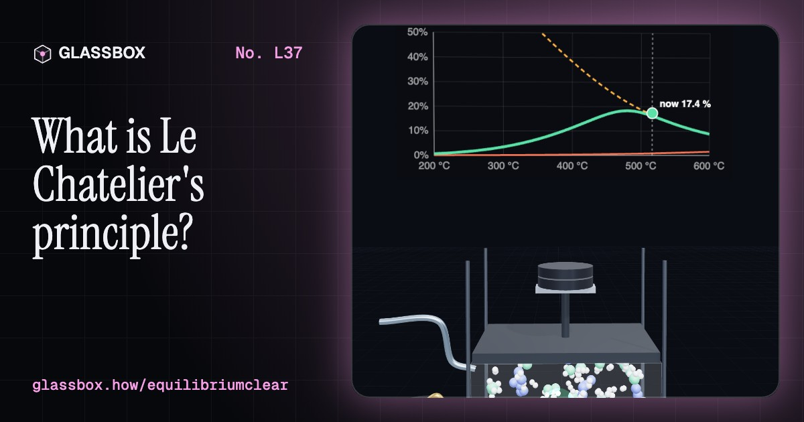
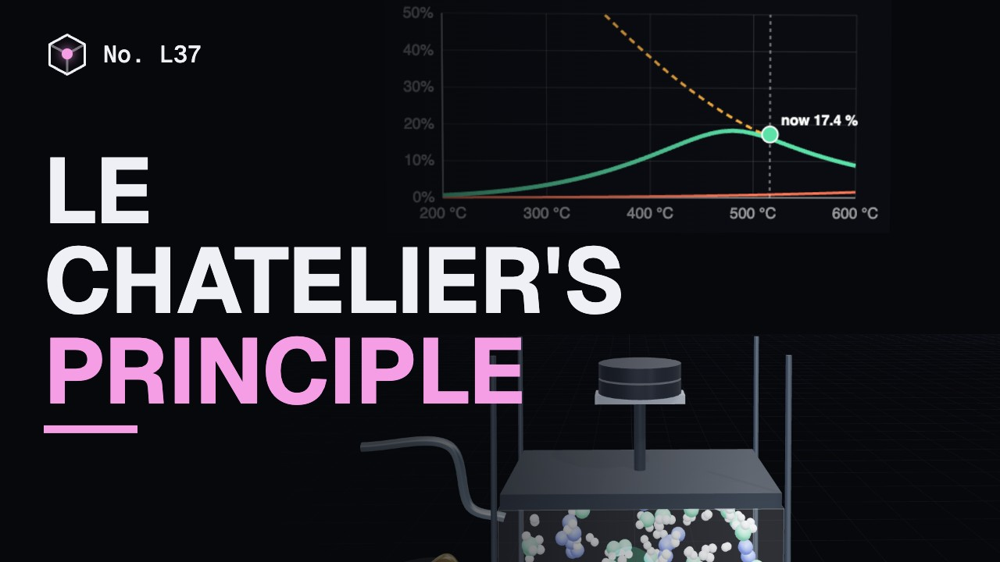
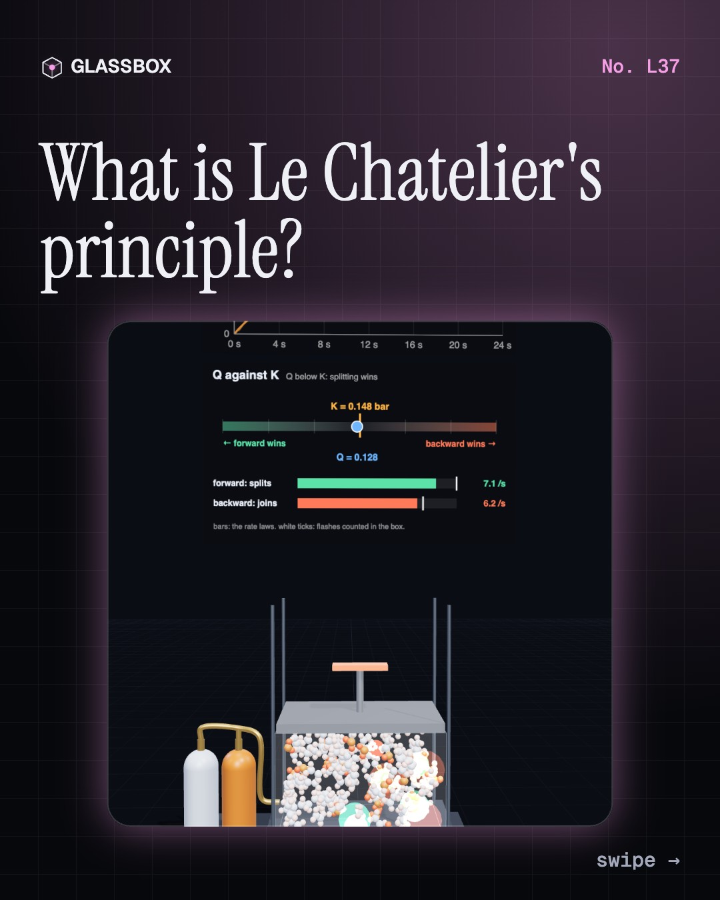
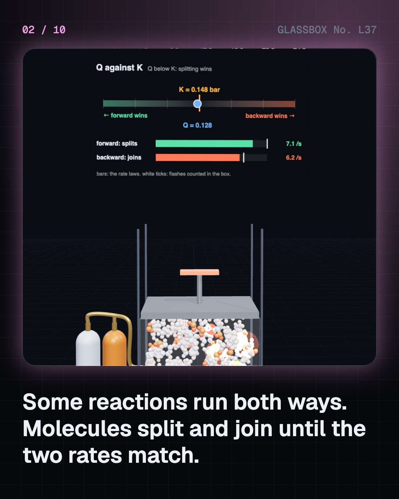
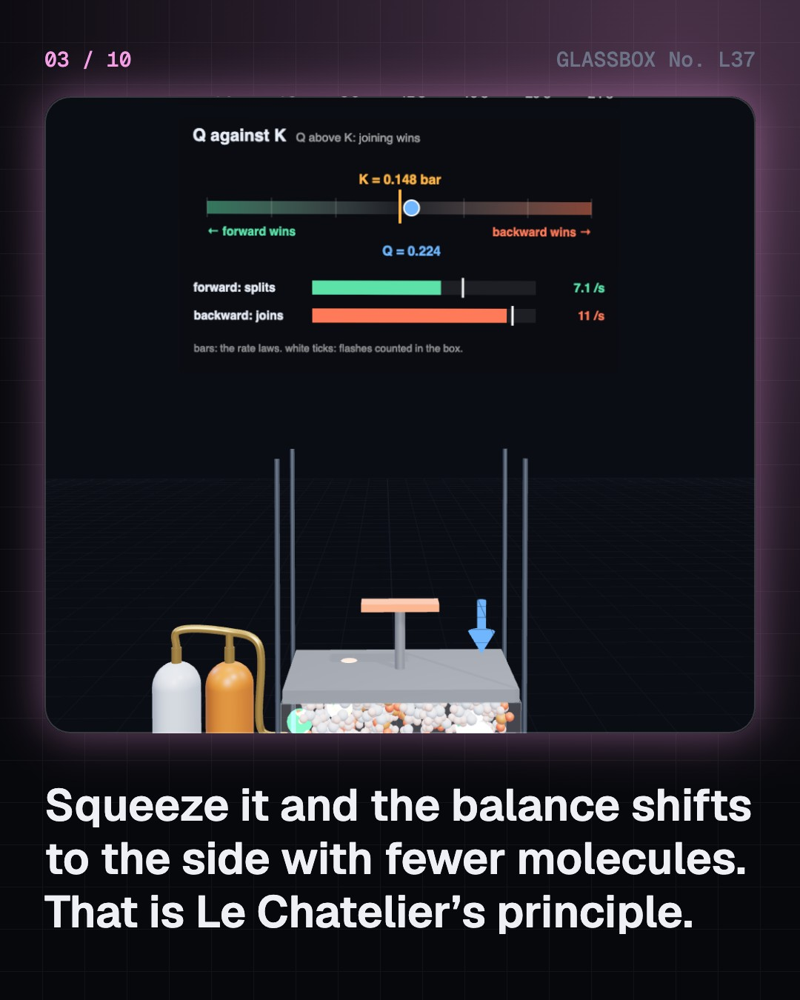
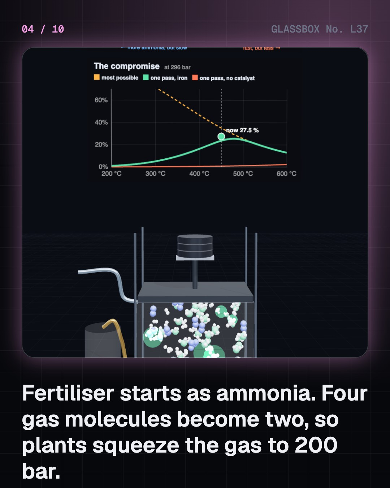

<!-- glassbox:start -->
<!-- Generated from glassbox.json by the Glassbox hub (npm run readme -- equilibriumclear). Edit glassbox.json, not this block. -->
<p align="center"><a href="https://glassbox.how/e/equilibriumclear/"></a></p>

<h1 align="center">Le Chatelier's principle</h1>

<p align="center"><b>What is Le Chatelier's principle?</b><br>At equilibrium a reaction has not stopped: molecules still split and join, at matching rates. Squeeze, heat or feed a live box of molecules and watch Q walk back to K. Then run a Haber converter at 200 bar, open a fizzy bottle, climb to Leh with your haemoglobin, fur up a kettle and grow a stalactite.</p>

<p align="center"><a href="https://glassbox.how/equilibriumclear/"><b>▶ Play with it</b></a> &nbsp;·&nbsp; <a href="https://glassbox.how/e/equilibriumclear/">Read the 60-second explainer</a> &nbsp;·&nbsp; <a href="https://glassbox.how/equilibriumclear/glassbox/reel.mp4">Watch the 40-second video</a></p>

<p align="center">
  <a href="https://glassbox.how/e/equilibriumclear/"></a>
  <a href="https://glassbox.how/e/equilibriumclear/"></a>
  <a href="LICENSE"></a>
  <a href="LICENSE-CONTENT.md"></a>
  <a href="#privacy"></a>
</p>

## In 60 seconds

1. **Both ways at once.** N₂O₄ ⇌ 2NO₂ runs forwards and backwards together. The amounts level off where the two rates match, with Q equal to K (0.15 bar at 25 °C). Squeeze the gas and it shifts to fewer molecules; heat it and K itself rises a hundredfold by 100 °C. The shift undoes part of the change, never all of it.
2. **Bread from air.** N₂ + 3H₂ ⇌ 2NH₃ gives out heat and halves the number of molecules. At 200 bar the balance holds 38 % ammonia at 400 °C, 27 % at 450 °C and 19 % at 500 °C. Plants accept about 15 % per pass at 400–450 °C over iron, tap off the liquid ammonia and recycle the rest to reach about 97 %.
3. **Fizz and breath.** A cola holds about 7 g/L of CO₂ under 4 bar; open it and Q leaps above K, so gas leaves. Haemoglobin is 98 % full at the 100 mmHg of oxygen in your lungs, about 75 % in resting muscle and far less in working muscle. At Leh's 3,500 m it fills to about 90 %.
4. **Scale and caves.** CaCO₃ + CO₂ + H₂O ⇌ Ca²⁺ + 2HCO₃⁻. Water under open air holds about 50 mg/L of limestone, under CO₂-rich soil air 200 mg/L or more. Boil it and the CO₂ leaves, so scale forms. Drip it into a cave and a stalactite grows, about 0.13 mm a year.
5. **Where the rule slips.** A catalyst speeds both directions equally and moves nothing. Argon pumped into a rigid tank moves nothing either, but under a free piston it shifts the balance back. Adding nitrogen to a nitrogen-rich ammonia mix makes more nitrogen. The words can mislead; comparing Q with K never does.

## Words worth knowing

| Term | Meaning |
|---|---|
| **Reversible reaction** | A reaction that can run forwards and backwards, written with the double arrow ⇌. |
| **Dynamic equilibrium** | The state in which forward and backward reactions run at equal rates, so amounts stay steady although molecules keep reacting. |
| **Equilibrium constant (K)** | The fixed value the ratio of products to reactants reaches at balance. It changes only with temperature. |
| **Reaction quotient (Q)** | The same ratio worked out for the mixture as it is now. If Q is below K the forward reaction wins; above K, the backward one. |
| **Le Chatelier's principle** | Disturb a system at equilibrium and it shifts in the direction that undoes part of the disturbance. |
| **Catalyst** | A substance that speeds a reaction without being used up. It speeds both directions equally, so it cannot move the balance. |
| **Henry's law** | The amount of gas a liquid holds at balance is proportional to the pressure of that gas above it. |
| **Yield** | How much product you get compared with the most possible. Equilibrium sets its ceiling; speed decides how close you come. |

## A short history

**From soda on an Egyptian lake shore to the reactors that grow half the world's food.**

- **1799** · Soda on the shore of a salt lake (Claude-Louis Berthollet, Natron Lakes, Egypt)
- **1850** · A balance that never rests (Alexander Williamson, Edinburgh (British Association meeting))
- **1864** · The law of mass action (Cato Guldberg and Peter Waage, Christiania (now Oslo))
- **1884** · How heat moves the balance (Jacobus van 't Hoff, Amsterdam)
- **1884** · Le Chatelier states his principle (Henry Louis Le Chatelier, Paris)
- **1909** · Ammonia, drop by drop (Fritz Haber and Robert Le Rossignol, Karlsruhe)
- **1913** · The first ammonia plant (Carl Bosch and Alwin Mittasch, BASF, Oppau, near Ludwigshafen)
- **1918** · A Nobel Prize, and a shadow (Fritz Haber, Stockholm)

The full story, with 20 moments, charts, people and 29 sources: [glassbox.how/e/equilibriumclear/history](https://glassbox.how/e/equilibriumclear/history/). The data lives in [`history.json`](history.json).

## Video and slides

Made with the Glassbox studio from this box's storyboard (`window.glassbox.director`). Free to reuse under CC BY 4.0.

<a href="https://glassbox.how/equilibriumclear/glassbox/video.mp4"></a>

<p><a href="glassbox/slide-1.jpg"></a> <a href="glassbox/slide-2.jpg"></a> <a href="glassbox/slide-3.jpg"></a> <a href="glassbox/slide-4.jpg"></a></p>

| File | What | Size |
|---|---|---|
| [`glassbox/reel.mp4`](https://glassbox.how/equilibriumclear/glassbox/reel.mp4) | Reel / Short, with captions and soundtrack | 1080×1920 |
| [`glassbox/video.mp4`](https://glassbox.how/equilibriumclear/glassbox/video.mp4) | YouTube video, with captions and soundtrack | 1920×1080 |
| `glassbox/slide-1…10.jpg` | Instagram carousel | 1080×1350 |
| `glassbox/thumb.jpg` | YouTube thumbnail | 1280×720 |
| `glassbox/cover.jpg` | Share card and repo social preview | 1200×630 |
| [`glassbox/history-reel.mp4`](https://glassbox.how/equilibriumclear/glassbox/history-reel.mp4) | “History in 10 moments” Reel / Short | 1080×1920 |
| `glassbox/history-slide-*.jpg` | History carousel | 1080×1350 |
| `glassbox/post.json` | Post copy and schedule used by the publish kit | |

## Privacy

This box has no accounts and no ads, and it ships its own fonts and libraries. When you run it yourself it sends nothing anywhere. On glassbox.how, the site's `/bar.js` also loads Glassbox's analytics: **Google Analytics** to count visits (it asks first in the EU, UK and Switzerland, and stays off when your browser sends Global Privacy Control or Do Not Track) and **ClickTrust** to detect bots.

It remembers a few things **in your own browser only**, and never sends them anywhere:

| Browser storage key | What it holds |
|---|---|
| `equilibriumclear.v1` | Which chapters you have opened, your best quiz scores, and sound on or off. |

Exactly what each one sees is at [glassbox.how/privacy](https://glassbox.how/privacy/).

## Licences

- **Code:** [MIT](LICENSE). Use it, change it, ship it.
- **Explanations, text, images and videos** (`glassbox.json`, `glassbox/`): [CC BY 4.0](LICENSE-CONTENT.md). Credit “Glassbox, glassbox.how/e/equilibriumclear”.
- **Third-party parts** keep their own licences: [three.js](https://threejs.org) (MIT), [Geist, Instrument Serif](https://openfontlicense.org) (SIL OFL 1.1).
- The Glassbox name and logo aren't covered by either licence. See the [terms](https://glassbox.how/terms/).

Found a mistake? [Open an issue](https://github.com/bdeeps/equilibriumclear/issues). Corrections happen in public.
<!-- glassbox:end -->

## Run it

It's plain HTML, CSS and JavaScript. No build step and no dependencies. Run locally, it contacts no other website.

```bash
python3 -m http.server 8000
```

Three.js and the fonts ship in `vendor/` and `fonts/`, so it also works offline.

Then open http://localhost:8000.

## How it's built

| File | What |
|---|---|
| `index.html`, `css/app.css` | The page and its styles |
| `js/app.js`, `js/stage.js`, `js/ui.js`, `js/kit.js` | The shared Glassbox 3D engine: chapters, 3D stage, controls, quiz, video director |
| `js/chapters/*.js` | One file per chapter: the 3D model, controls, text, key terms, quiz and video scenes |
| `js/eq.js` | Shared chemistry and parts: equilibrium constants from published data (N₂O₄, ammonia with fugacity corrections, Henry's law for CO₂, the haemoglobin curve, calcite in water), the model rate laws, the box of reacting molecules, chart boards and the Q-against-K bar |
| `glassbox.json` | Title, question, explainer beats, key terms, browser storage and credits shown on glassbox.how |
| `reel` in each chapter | The storyboard the Glassbox studio records into short videos |
| `glassbox/` | The published video, slides, thumbnail and post copy |
| `fonts/`, `vendor/three/` | Self-hosted Geist and Instrument Serif (SIL OFL 1.1) and three.js (MIT) |
